# Drifting 图预设视觉对照

这是 TUI 图形层的自动捕获样稿，用来比较同一视口中的空间图、二维张量流和两档爆炸间距。它记录画面差异，不代表用户任务测试或原生终端体验结论。

## 捕获条件

- 当前 TUI 工作树，内置 Drift-L / `DitGen` 样例。
- 120×36 视口。Drift-L / Drift-B 字符帧选中 `DitGen.backbone`、结构总览第 1/5 页；QKV 字符帧通过 `/block_07.attention.qkv` 搜索定位同一个 `DitGen.backbone.blocks.block_07.attention.qkv`。
- 像素渲染；`TERM=xterm-kitty`、`MODEL_MAVEN_GRAPHICS=pixels`、`MODEL_MAVEN_REDUCE_MOTION=1`。捕获时移除了环境中继承的 `NO_COLOR=1`。
- 先捕获 3D 基准，按 `z` 捕获二维视图，按 `z` 返回 3D，再按 `x` 两次捕获两档爆炸间距。每张 PNG 是 TUI 发送的 Kitty RGBA 图像层，终端文字标签和状态行由字符层绘制，因此不包含在 PNG 内。
- 对照样稿还用 `--drifting-source ./fixtures/drifting --drifting-config ./fixtures/drifting/configs/gen/latent_sota_B.yaml` 捕获了 Drift-B 的根级画布；TUI 显示 `width: 768 · heads: 12`。同一根级连线拓扑与 Drift-L 相同，因此没有重复嵌入相同像素图。
- 上述 12 张无色 `.txt` 帧由真实 TUI 在 120×36 tmux 伪终端中分别捕获 Drift-L、Drift-B 和 QKV 选区的四种预设；运行时设为 `NO_COLOR=1`、`MODEL_MAVEN_GRAPHICS=cells`，并启用 reduce motion。可用 `python3 scripts/capture_preset_cells.py` 按当前相机预设重采 20 张 120×36 Drift-L/Drift-B/QKV/block_07/residual 帧及 2 张 40×24 窄屏爆炸帧；脚本核对选中实体、视图模式、相机角度与窄屏页码可见。12 张 PNG 则由同一图场景和像素渲染器确定性重建，不包含终端字符层或 Kitty 复合效果。使用 `MODEL_MAVEN_PRESET_CAPTURE_DIR=docs/graph-preset-samples cargo test --bin m-model-tui capture_drifting_visual_review_samples_when_requested -- --nocapture` 可重建 PNG。
- 重复 block 对照将查询固定为 `DitGen.backbone.blocks.block_07`，展示 24 个块中的同一选中实例和相邻页；字符帧取自真实 TUI 的 120×36 tmux 捕获，PNG 由像素场景测试重建。此次检查发现全屏图形区实际是 35 行，x1 时 `block_07` 标签落出可见区；布局现为爆炸竖排预留上下空间，并以 35 行场景断言选中标签保留。
- `attention_residual` 同组选区增加四张 120×36 无色字符帧和对应 PNG，以及一张 40×24 翻页帧；复现 PNG 使用上方同一捕获测试。
- 图标题现在在最前面标出 `SPATIAL 3D`、`2D FLOW` 或 `EXPLODE x1/x2`，模式信息在窄屏与工具栏争用标题宽度时优先保留；三种语言在 34/40 列测试中均能辨认当前预设。

## 同页样稿

### 空间视图

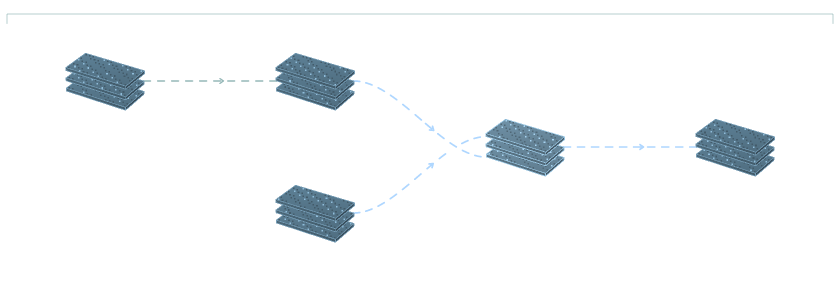

斜视可快速看出分支汇合和层叠结构。相似的切片纹理无法单独表达模块实例编号，必须结合终端中的标签和选中详情阅读。无色字符帧：[Drift-L](graph-preset-samples/drifting-spatial-cells.txt)、[Drift-B](graph-preset-samples/drift-b-spatial-cells.txt)。

### 二维张量流

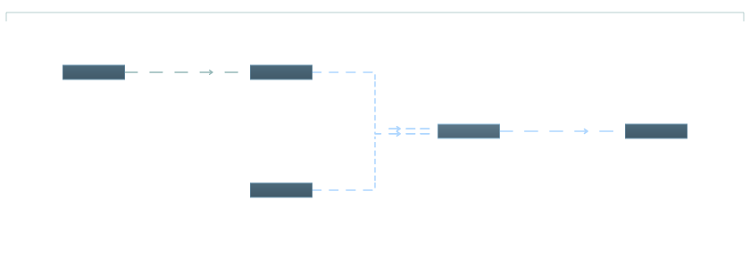

正交路径更容易沿主干读到汇合点与后续输出；交汇处仍会聚集多条平行线，密集模型需要继续检查路径间距和选择反馈。无色字符帧：[Drift-L](graph-preset-samples/drifting-flow-2d-cells.txt)、[Drift-B](graph-preset-samples/drift-b-flow-2d-cells.txt)。

### 爆炸间距 1/2


无色字符帧：[Drift-L](graph-preset-samples/drifting-exploded-1-cells.txt)、[Drift-B](graph-preset-samples/drift-b-exploded-1-cells.txt)。

### 爆炸间距 2/2

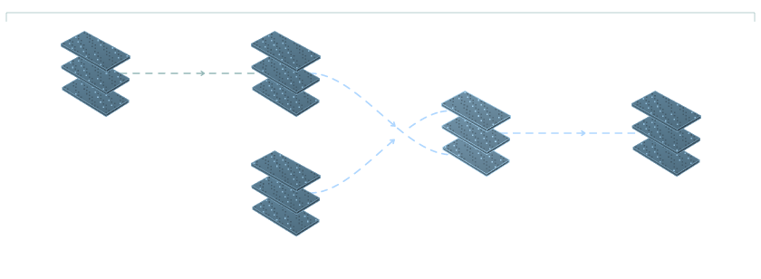

无色字符帧：[Drift-L](graph-preset-samples/drifting-exploded-2-cells.txt)、[Drift-B](graph-preset-samples/drift-b-exploded-2-cells.txt)。

两档间距现在有清楚的视觉差别，x2 会把切片拉得更开；同时保留模块连线和方向。间距表示切片展开程度，不能代替模块类型或实例身份，仍需结合标签、详情和稳定连线确认。

选中的多片 stack 现在在 60 列及以上的爆炸视图里为每个可见切片加 `s1`、`s2`…序号。标号从 1 开始显示，对应稳定的零起始 slice ordinal；它只表达渲染切片顺序，不代表 CLI 报告的子模块名称。40×24 下隐藏这些标签以保留图形空间；同一个窄屏样稿仍验证页码、连接点阵与选中模块。

空间视图、爆炸 x1 与爆炸 x2 现在各自记住相机角度和缩放/平移。按 `x` 切换预设时保留同一焦点，返回预设可恢复该预设上次的视角；导航书签也恢复当前展开档位与三种空间视角。 爆炸预设首次进入和复位采用等轴相机：水平转角 45°，俯仰 arctan(1/√2)≈35.3°，正交投影下三条空间主轴长度相等；空间 3D 仍以 32°/30° 作为独立初始视角。各预设可继续单独旋转并记住调整值。相机投影等轴性由几何测试验证，100×30 与 120×36 最终屏幕样稿显示 `CAM 045°/+35°`。

### 重复 block 的连续层序

搜索并定位 `DitGen.backbone.blocks.block_07` 后，在同一选择下切换四种预设。空间与二维视图展示 block_07 邻近实例，爆炸 x1/x2 以纵向层片保留方向和选中标签；x1 的视口边界缺标签问题已按真实 35 行图形区修正。字符场景还覆盖 40×24、80×24、100×30、120×36 实际图区高度以及四个 yaw 相位，确保两档爆炸视图中的当前 block 标签仍在画布内。

| 视图 | 像素画布 | 无色字符帧 |
| --- | --- | --- |
| 3D 空间 | 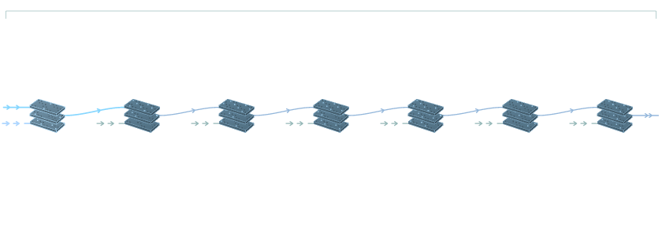 | [字符帧](graph-preset-samples/drifting-blocks-spatial-cells.txt) |
| 2D 张量流 | 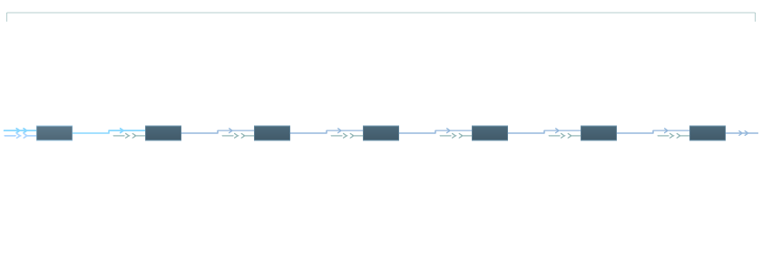 | [字符帧](graph-preset-samples/drifting-blocks-flow-2d-cells.txt) |
| 爆炸 1/2 |  | [字符帧](graph-preset-samples/drifting-blocks-exploded-1-cells.txt) |
| 爆炸 2/2 |  | [字符帧](graph-preset-samples/drifting-blocks-exploded-2-cells.txt) |

这些帧验证同一 block 的选择与相邻实例标签，不代表残差旁路或块内拓扑；QKV 作用域见下一节。字符帧来自真实 TUI，PNG 展示像素图形层，不含终端文字标签。

### 无色模块表面颗粒

Embedding、Attention、Linear、Add 与 TransformerBlock 使用不同的 Braille 颗粒密度，帮助在无色字符视图里快速区分表面纹理。固定尺寸样稿验证五类纹理有差异，投影命中轮廓相同。纹理只是视觉线索，模块类型和实例身份仍由名称与详情文字确认。

图中按 `v` 打开模块详情会显示对应的“表面纹理提示”，并已覆盖英文、简体和繁体；因此纹理可以按需核对，无须在画布上常驻一份图例。

- [30×20 无色纹理对照帧](graph-preset-samples/module-grain-cells.txt)
- 可用 `MODEL_MAVEN_GRAIN_CAPTURE_DIR=docs/graph-preset-samples cargo test --bin m-model-tui module_families_have_distinct_monochrome_surface_grain_without_geometry_changes -- --nocapture` 重建。

### 空间图焦点呼吸

选中模块周围增加独立菱形轮廓。轮廓按 2.8 秒余弦周期在收缩态和扩张态间平滑变化；收缩态也略大于模块边界，扩张态外沿更清楚。无色 Braille 与像素渲染分别通过字符点位和强调色/尺寸表达呼吸，标记不改变表面采样或命中目标。

| 阶段 | 像素画布 | 无色字符帧 |
| --- | --- | --- |
| 收缩 | 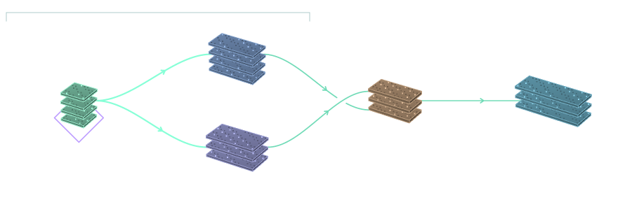 | [字符帧](graph-preset-samples/focus-breathe-rest-cells.txt) |
| 扩张 |  | [字符帧](graph-preset-samples/focus-breathe-peak-cells.txt) |
| 选择反馈峰值 | 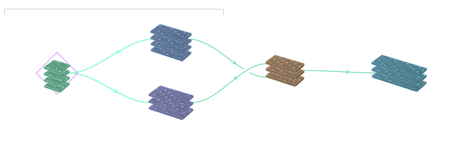 | [字符帧](graph-preset-samples/focus-feedback-feedback-cells.txt) |

固定相位样稿用于检查呼吸和选择反馈的幅度及遮挡，不等同于运动感受测试。选择反馈峰值是 800ms 脉冲的正中相位；可在仓库根目录用 `MODEL_MAVEN_FOCUS_CAPTURE_DIR=docs/graph-preset-samples cargo test capture_focus_breathe_review_samples_when_requested -- --nocapture` 重新生成。

### block_07.attention.qkv 展开作用域

搜索并定位 `DitGen.backbone.blocks.block_07.attention.qkv` 后，同一选择下的预设帧如下。窄长画布能完整呈现 Q/K/V 分支；爆炸视图把支路改为纵向分段，拓扑更易逐层追踪。节点高度现在按可用层间距伸展，120×36 的两档样稿中切片更醒目，Q/K/V 分支和文字标签仍可辨认。

| 视图 | 像素画布 | 无色字符帧 |
| --- | --- | --- |
| 3D 空间 | 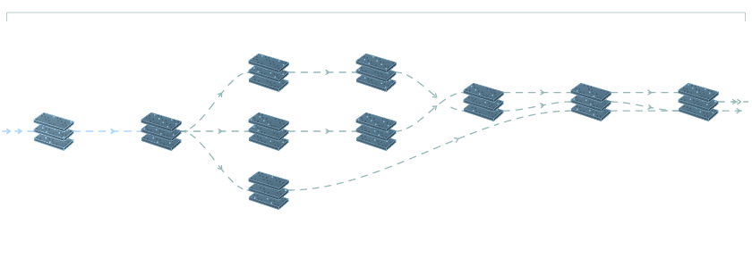 | [字符帧](graph-preset-samples/qkv-spatial-cells.txt) |
| 2D 张量流 | 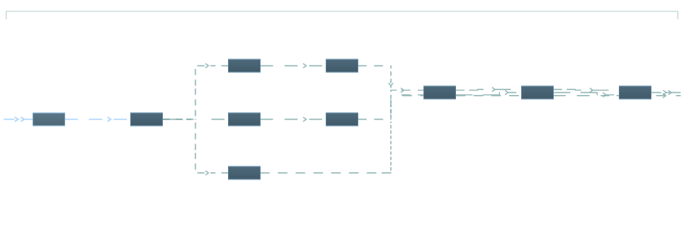 | [字符帧](graph-preset-samples/qkv-flow-2d-cells.txt) |
| 爆炸 1/2 | 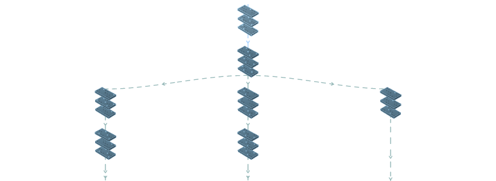 | [字符帧](graph-preset-samples/qkv-exploded-1-cells.txt) |
| 爆炸 2/2 | 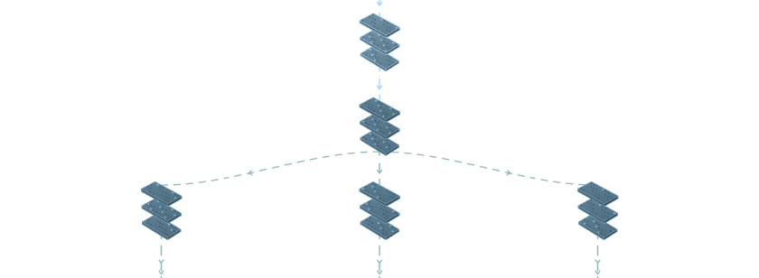 | [字符帧](graph-preset-samples/qkv-exploded-2-cells.txt) |

### block_07 残差汇合

搜索 `DitGen.backbone.blocks.block_07.attention_residual` 后，二维图保留 attention、residual add、norm2 等相邻节点和已记录边；两档爆炸视图把选中残差节点及邻接关系展开到纵向层片。40×24 TUI 回放确认窄屏可翻页找到 `attention_residual`，详情显示类型 `Residual add`；120×36 同选区样稿用于观察同组上下文。

| 视图 | 像素画布 | 无色字符帧 |
| --- | --- | --- |
| 3D 空间 | 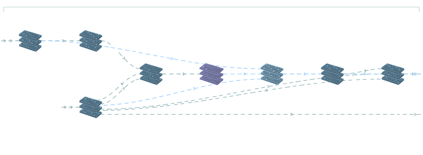 | [字符帧](graph-preset-samples/drifting-residual-spatial-cells.txt) |
| 2D 张量流 | 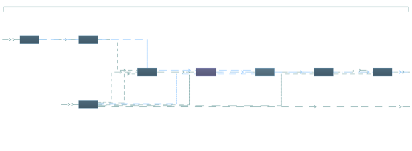 | [字符帧](graph-preset-samples/drifting-residual-flow-2d-cells.txt) |
| 爆炸 1/2 |  | [字符帧](graph-preset-samples/drifting-residual-exploded-1-cells.txt) |
| 爆炸 2/2 |  | [字符帧](graph-preset-samples/drifting-residual-exploded-2-cells.txt) |

40×24 翻页后的残差节点：[窄屏无色字符帧](graph-preset-samples/drifting-residual-40x24-cells.txt)。字符帧来自真实 TUI 的无色 tmux 捕获；PNG 是测试重建的透明图形层，不含文本。样稿确认局部节点、类型和相邻关系可辨认，不代表真实用户任务的误认率或定位耗时。

### 40×24 爆炸视图与页码

流图爆炸视图在 60 列以下使用纵向分层布局；x1/x2 状态行把当前页范围前置，避免窄屏裁掉页码。Drift-L 样稿选中 `DitGen.backbone`，当前页分别为 x1 的 `4–5/5` 和 x2 的 `4–4/5`，用户可按 `[`/`]` 回看同一层级的其他页。字符帧由真实 TUI 的 tmux 回放生成；捕获脚本会断言 24 行、选中模块和页码均可见。数据测试另按 40×24 的两档爆炸间距和四个旋转角检查 Braille 路由点阵非空，并继续核对切片覆盖与连线对象身份。

| 视图 | 40×24 无色 TUI 帧 |
| --- | --- |
| 爆炸 x1 | [字符帧](graph-preset-samples/drifting-narrow-exploded-x1-40x24-cells.txt) |
| 爆炸 x2 | [字符帧](graph-preset-samples/drifting-narrow-exploded-x2-40x24-cells.txt) |

### 窄屏预设快捷键

图焦点下可直接按 `1` 进入空间 3D、`2` 进入可用的 2D 流图、`3`/`4` 进入爆炸 x1/x2；当前数据没有可用流图时会省略 `2`。在真实 40×24 tmux 帧中，预设键位保持完整可见；依次按 `4`、`3` 后，标题分别显示 `exploded slices 2/2` 与 `exploded slices 1/2`，选中的 `net.head` 不变。

- [40×24 无色 x2 窄屏帧](graph-preset-samples/last-observed-narrow-40x24.txt)
- [100×30 空间 3D 无色帧](graph-preset-samples/toolbar-spatial-100x30-cells.txt)
- [100×30 二维流图无色帧](graph-preset-samples/toolbar-flow-2d-100x30-cells.txt)
- [100×30 爆炸 x1 无色帧](graph-preset-samples/toolbar-exploded-x1-100x30-cells.txt)
- [100×30 爆炸 x2 无色帧](graph-preset-samples/toolbar-exploded-x2-100x30-cells.txt)

四帧由 `scripts/verify_tmux.py` 在同一 48/32 选中连线下真实启动 TUI 捕获，展示提示栏始终可见的模式按钮和 active mark；捕获自动检查四帧均为 100×30 且命中预期标记。

宽度至少 92 列时，鼠标工具栏在原缩放/方向/重置/定位按钮后增加可点按的 `[1][2][3][4]` 图预设；当前预设以 `{1}` 至 `{4}` 标出，括号字符在无色终端中提供持久选中提示，且宽度与未选按钮相同。36–91 列保留原紧凑工具栏，无流图时二维按钮显示为不可用。100×30 字符和像素伪终端均通过 SGR 点击四按钮并检查空间、爆炸 x1/x2 和二维状态；Tmux 最终屏幕断言确认工作台提示栏中的四种当前标记持续可见。单元测试核对选区身份、四种当前标记及英/简中/繁中悬停说明（含二维不可用原因）。隔离 tmux 自动回放在 100×30 交叉端口故障样例中依次检查四个数字预设，再验证两条交叉连线仍能被分别选中；二维状态打开命令搜索时，流图动作正确显示返回三维的 `1/z`，矩阵动作显示 `M`；搜索 `spacing` 后按 Enter 可直接进入爆炸 x1。40 列搜索结果用短标签保留快捷键及禁用原因。另在 40×24 Last Observed 视图核对 x1/x2 切换和完整键位提示。运行 `python3 scripts/verify_tmux.py` 重现。图操作帮助页把 `M Port matrix` 与 `F Failure path` 并列展示，三维/二维/爆炸按钮与矩阵、故障路径及修复差异的键盘入口都可查找。两种尺寸均为终端单元格回放，不代表原生终端鼠标体验。

### 单色图中的选中连线方向

固定一条连线后，方向箭头会比普通连线更大，帮助在无色 Braille 图里识别当前路径；路由端点、连线身份和命中几何保持不变。交叉端口样例的两条不同选中状态由 `scripts/verify_tmux.py` 在 100×30 tmux 中真实捕获，脚本核对两条线都可选且无色栅格随选择更新。

- [选中 encoder 0 → merge 1](graph-preset-samples/crossed-ports-selected-a-100x30-cells.txt)
- [选中 encoder 1 → merge 0](graph-preset-samples/crossed-ports-selected-b-100x30-cells.txt)

## 其他图形预设

### 故障路径

故障路径先给出失败调用、报告和批次，再沿输入列出来源边界、观测与声明形状。窄屏帧中 `Esc` 返回提示保持完整；`v` 可查看调用证据，Enter 返回图中同一输入位置。

- [80×30 无色字符帧](graph-preset-samples/failure-path-cells.txt)
- [40×24 无色字符帧](graph-preset-samples/failure-path-40x24-cells.txt)
- [40×24 简体中文无色字符帧](graph-preset-samples/failure-path-40x24-zh-cells.txt)

### 端口邻接矩阵

矩阵用符号区分错配、已记录匹配、未知形状、已声明无连线和未知关系。默认网格以短索引保持紧凑，选中格下方给出完整端口对；`a` 打开行/列轴索引。分组视图显示聚合端口范围、记录数与覆盖情况。

- [80×30 矩阵](graph-preset-samples/crossed-ports-matrix-cells.txt)
- [40×24 矩阵](graph-preset-samples/crossed-ports-matrix-40x24-cells.txt)
- [行列轴索引](graph-preset-samples/crossed-ports-matrix-axis-cells.txt)
- [分组矩阵与覆盖摘要](graph-preset-samples/crossed-ports-matrix-grouped-cells.txt)

### 修复差异

宽屏并排呈现修复前后端口、形状与权重影响；窄屏切换到单侧，保留目标和预览状态。

- [100×30 无色字符帧](graph-preset-samples/repair-diff-cells.txt)
- [40×24 无色字符帧](graph-preset-samples/repair-diff-40x24-cells.txt)

## 命令搜索窄屏样稿

40×24 下搜索标题完整显示 graph/source/evidence/commands 四类范围。动作结果并列显示当前有效键位和紧凑状态名；故障路径、修复差异等禁用动作仍保留简短原因。样稿中 2D 流图显示 `2/z`，矩阵显示 `M`，修复差异显示 `D · need preview`。

- [40×24 无色字符帧](graph-preset-samples/command-search-40x24-cells.txt)

## 本次发现与后续验收

- 二维视图更适合辨认顺序和分支关系；空间/爆炸视图更适合观察节点层级和局部切片。两者应保留同一模块与端口选择。
- 为比较交叉，分层布局改用 median crossing minimization。将分层布局的交叉最小化策略改为 median。测试按 TUI 路由器的相交标记成对计数：120×36 Drift-L 根视图空间图为 1 处、二维图为 2 处；展开到 block_07.attention 后，从旧策略的 16/25 处降至 1/4 处；同尺寸 crossed-ports 夹具为 2/3 处。所有端口连线在切换视图前后保持一致；根图和注意力作用域分别重复绘制两种预设，路由端点及折点坐标逐项一致，视图往返后模块与连线选择身份不变。另用内置 Drift-L 走真实 zoom/返回路径展开 `DitGen.backbone`，二维根视口中的可见节点顺序、中心坐标、路由端点及折点保持完全一致，节点与端口连线选择也恢复到原身份。计数是自动几何指标，不代表人的误选率或定位耗时；二维仍略多交叉，选中线身份、端口详情和视图往返必须保持可核对。
- `block_07` 作用域展示 Q/K/V 及 `reshape_qkv`。纵向爆炸图按可用层间距动态分配节点高度；数据测试覆盖 40×24、100×30、120×36 的层片保留、命中和连线续接，并检查中、大视口的放大效果。窄屏读屏与真实任务定位仍需继续走查。
- 字符帧确认 40×24 的故障路径导航提示可读，矩阵及修复差异都有窄屏布局；伪终端帧仅用于检查布局，不等同于原生终端。遮挡率、定位用时、误选率和返回焦点仍需用 Drift-L、Drift-B、密集端口及窄屏的任务回放验证。自动样稿没有记录人的定位耗时，真实用户走查和 Ghostty 原生窗口尚未完成。


### 宽屏工具栏启用边界

91 列保留原紧凑工具栏；92 列开始显示四个数字预设入口。新增字符伪终端回放在 91/92 列对照工具栏，并在 92 列最末单元格点按 x2，确认该入口能正常展开。复现：

```sh
cargo test --test welcome graph_mode_toolbar_uses_the_exact_92_column_boundary
```

该检查验证终端单元格和 SGR 事件映射，不代表 Ghostty 或触控板原生体验。

### 修复草稿跨预设保持

在同一 mismatch 修复预览中，依次切换爆炸 x1、x2、空间 3D、二维流图，再返回 x2 和空间 3D。字符与像素场景都验证 Draft 标记仍落在原输入端口，选中的连接及图版本保持不变。复现：

```sh
cargo test --bin m-model-tui preview_overlay_and_target_survive_graph_preset_changes
```

这是场景级自动回归；真人任务中是否容易分辨草稿与已提交状态仍需走查。

### 爆炸图切片可见字符格检查

测试用 Braille 深度栅格现在按 `(operator ID, slice ordinal)` 区分切片，并统计每片覆盖的字符格；原来的模块标签及连线附着检查继续运行。选中模块每片在 40×24、100×30、120×36 视口、爆炸 x1/x2 和四个相机方位下至少覆盖 2 个字符格。

```sh
cargo test --bin m-model-tui exploded_slices_keep_module_identity_and_connectors_attached
```

字符格覆盖是遮挡的自动几何底线，不表示切片容易辨认，也不代表人工误认或定位时间结果。身份追踪只存在于测试构建。

**可见面积下界。** 切片身份检查使用无色 Braille 栅格统计可见字符格，而不只统计单个点。当前选中 stack 的每片在 40×24、100×30、120×36 下，x1/x2 和四个相机方位至少覆盖 2 个 Braille 字符格。窄屏 x1 的某些旋转角只有 2 格；尝试用 4 格作为门槛会失败，因此保留真实通过的 2 格底线，并把这一姿态留给人工辨认走查。该下界不声称两格一定容易读。
